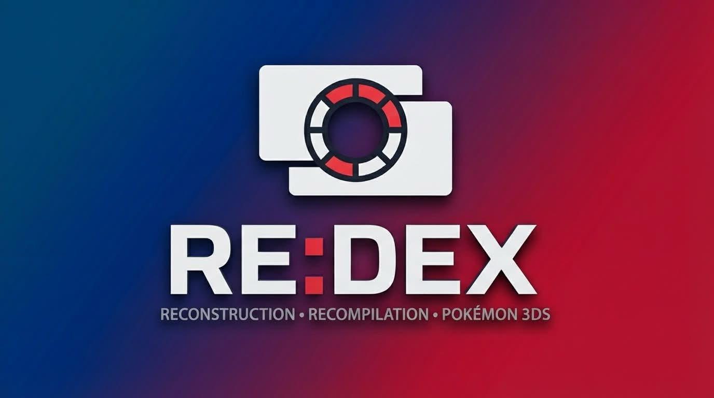

  

  

**RE:DEX** turns Pokémon X and Y (Nintendo 3DS) into a native PC game with a shared online world: X and Y players walk Kalos together and see each other's trainers, in the outfits they made. Written in Rust.

- **Native, not emulated.** The game's ARM11 code is translated ahead of time to C and built on your PC from **your own** decrypted dump on first launch. This repository contains no Nintendo code or assets.
- **One world, both versions.** X and Y cross-play on the official RE:DEX world (sign in from the start screen with a RE:DEX account) or on community-hosted `redex-world` servers over Steam. If the official service can't be reached, you can still play peer-to-peer with the characters on your PC. Players nearby, whispers, reports and an Ignore list are in; trades, battles and a market come later, each behind server-side legality checks.
- **Your own front door.** A start screen with a game builder, cross-game characters and a 3D character creator, ahead of the 3DS title screen.
- **PC features.** High frame rates with *Smooth motion* (up to your monitor's refresh rate), resolution scaling, controller support, texture packs.
- **Discord status.** Your Discord profile shows the game, the mode and your play time, if Discord is running.
- **Fair online.** Fast forward, dev tools, local-wireless rooms and game-changing mods are off while you're in a world.

**How to play.** Download the release folder and run `redex.exe`. Press *Add your game*, pick your own decrypted Pokémon X or Y dump (`.cci` or `.3ds`), and wait while RE:DEX builds it on your PC (a few minutes, the first time only). Then make a character and press Play. Everything it needs is in the folder; nothing else has to be installed. Maintainers build the folder with `tools/release/make-release.ps1`.

**Your character.** The start screen keeps your characters, up to 8. *New character* opens the creator: pick a boy or a girl, skin, hair style and colour, and eyes, and name them. The preview is the game itself drawing your trainer, so what you see is what you get; drag it to turn the model, scroll to zoom. A character plays in both X and Y: a new game starts as them (their name, gender and look), and *Import a save* brings in an existing `main` save (copied, never moved) from RE:DEX's own save folder, Citra or Azahar, or a Checkpoint backup. *Remove character* takes one off the list (after asking) and leaves its saves on disk. Each character has its own saves, and RE:DEX backs them up before every launch. Clothes you buy in a boutique stay with the character, in the other game too. Online, your characters live on your account, so they are there on any PC you sign in on, and other players see the look you made.

**Mods.** The start screen's *Mods* button lists the Pokémon X and Y mods on GameBanana and installs texture packs and skins with one press; turn them on and off there. Skins and texture packs play online (only you see them); mods that change game data are marked *Offline only*. See [docs/mods.md](docs/mods.md).

Status: early development. Community: [Discord](https://discord.gg/NTSvuGWnWj).

Unofficial fan project, not affiliated with or endorsed by Nintendo, Game Freak, Creatures Inc. or The Pokémon Company.
